# 📊 UIII Act3: Importación y Descripción de Datos

> **🎓 Asignatura:** Soluciona problemas de Machine Learning  
> **📚 Nivel:** Tercer semestre de preparatoria  
> **🤖 Especialidad:** Inteligencia Artificial  
> **📈 Dificultad:** Cero a principiante  
> **🐍 Lenguaje:** Python  
> **🛠️ Herramientas:** Visual Studio Code, Pandas, Matplotlib y CSV  

## tipos de tractores 0085
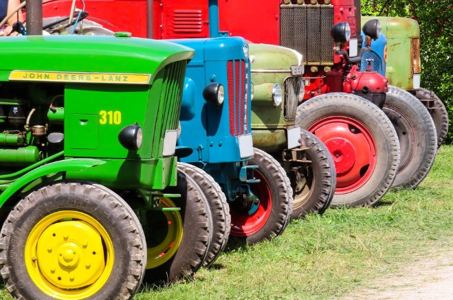

## tabla original
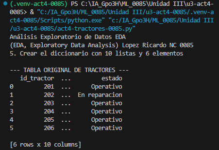

## convertir dataframe en archivo
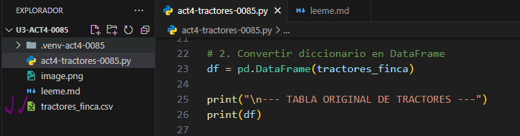

## datos del csv
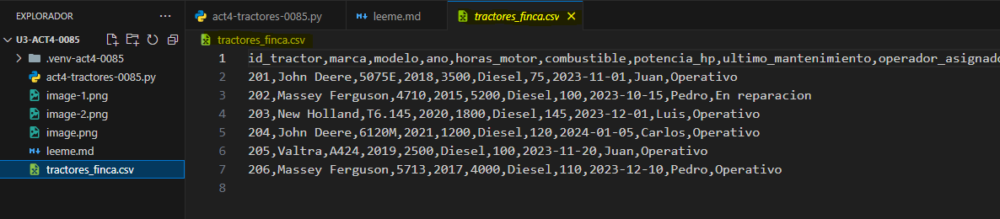

## leer datos desde el archivo csv
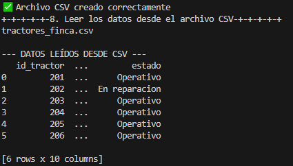

## análisis explotarotorio de datos
# primeros y últimos registros
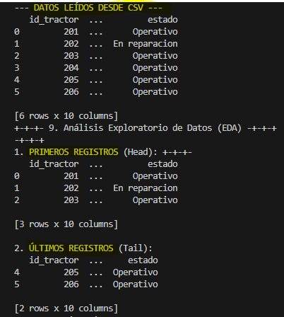

## dimensiones y estructura 
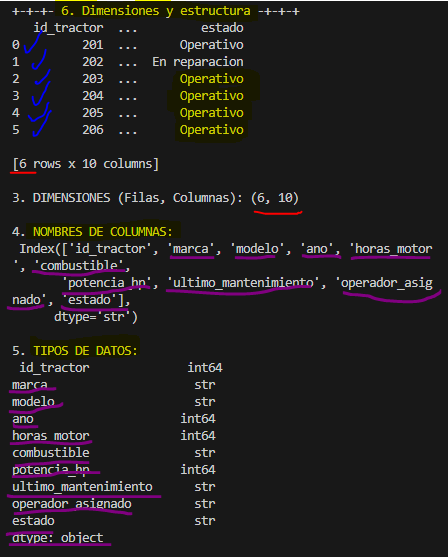

## estadisticas de tractores
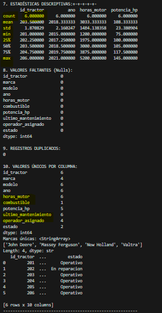

## 8 y 9. Ordenamiento, filtrado y agrupación
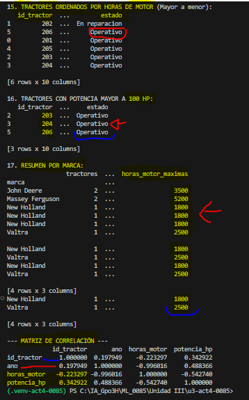

## Gráfica de barras: tractores por marca
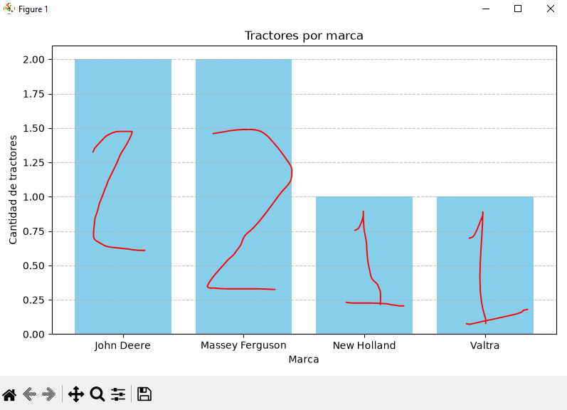

## Gráfica de barras:horas de motor por tractor
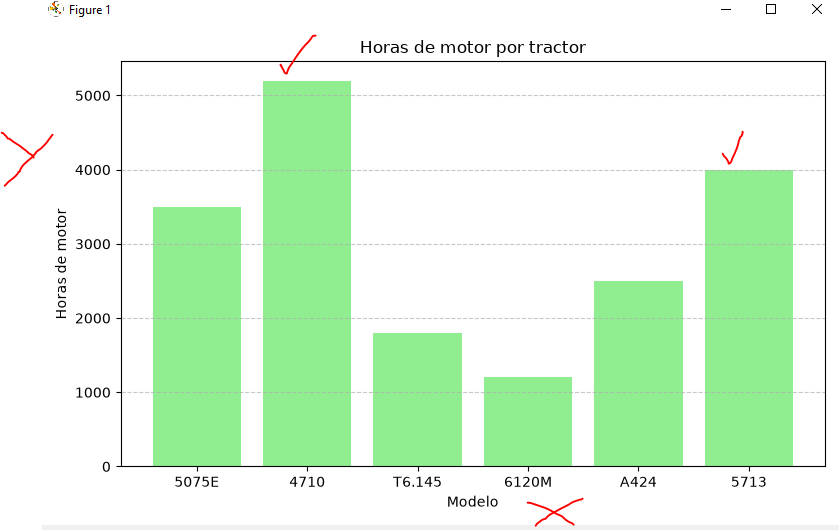

## Histograma:distribucion de los años de tractores
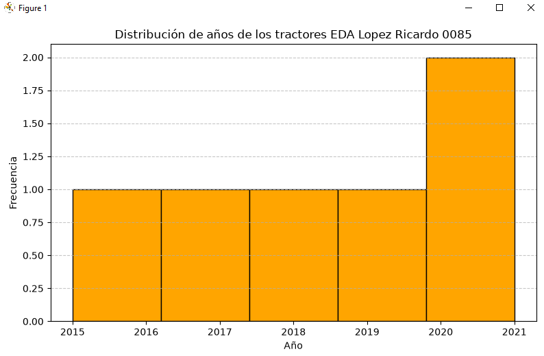

## Gráfica de dispersión:relacion entre potencia y horas
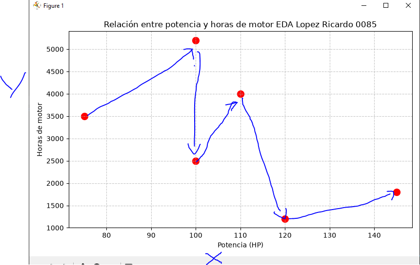

## Diagrama de caja:distribucion de horas de motor
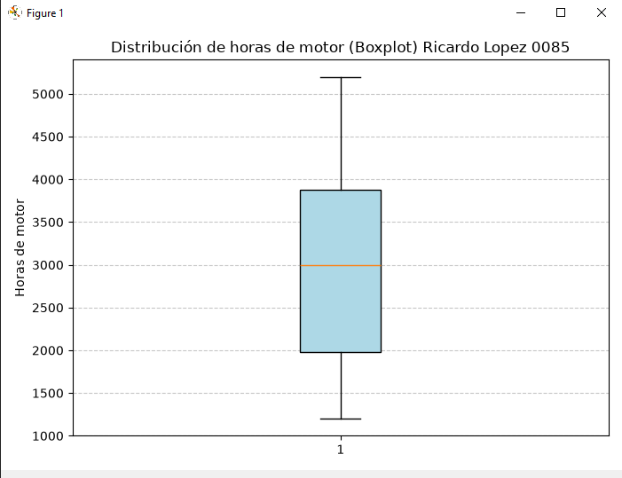

## Matriz de correlación
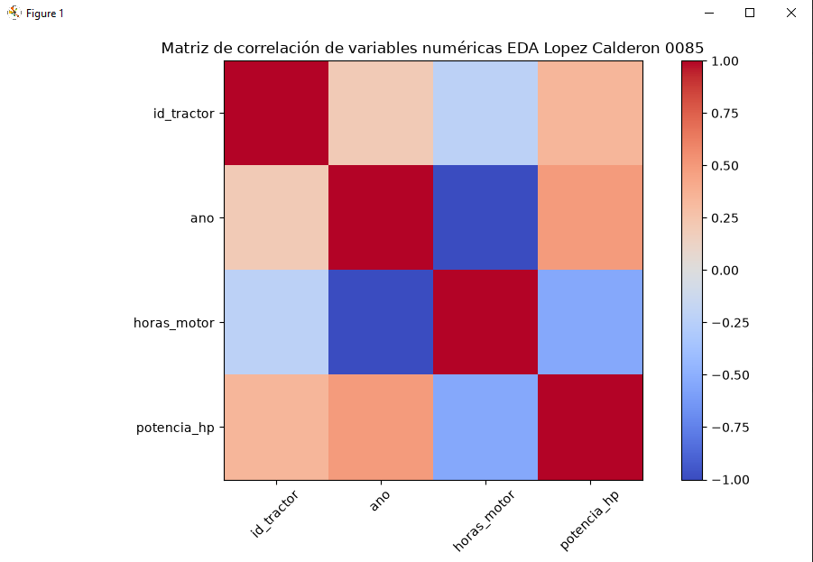